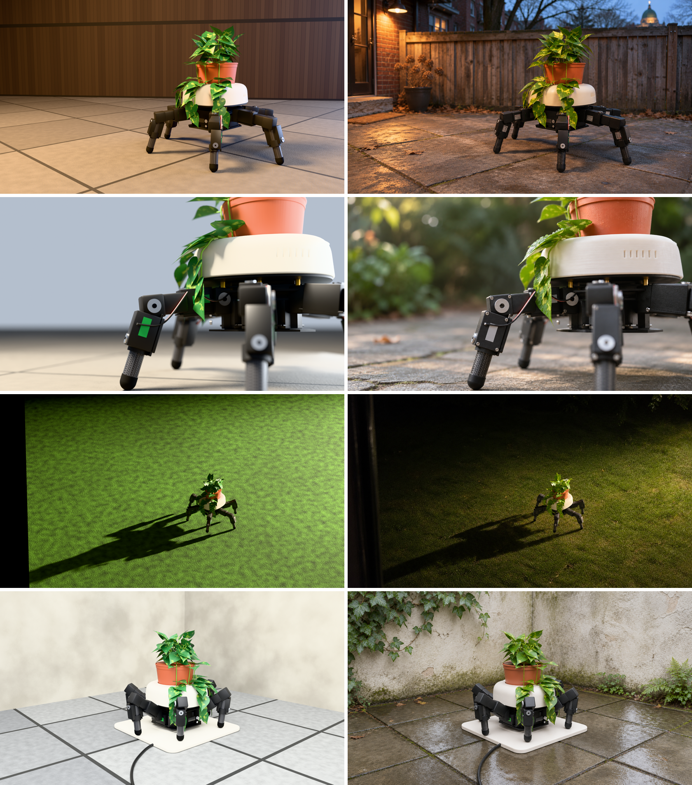

# Concept Lab

Give it a project idea; get back the project as if it were already built. A brief with real,
priced parts, a scaffold repo, a 3D model you can turn, photos of it where it would live, a
short video of it moving, and a page under **Concepts** on
[vyhouski.com/projects](https://vyhouski.com/projects).

It is for ideas Nick plans to build but has not yet: the page shows the plan in execution
before the build exists.



## Concepts

| Concept | Idea | Page | Code |
|---|---|---|---|
| Robot Planter | A plant pot on wheels that finds the sun and wanders the yard at night | [live](https://vyhouski.com/projects/robot-planter) | [weeeha/robot-planter](https://github.com/weeeha/robot-planter) |
| Walking Planter | The same idea on a Waveshare HexArth hexapod: sits all day, walks to follow the sun | [live](https://vyhouski.com/projects/walking-planter) | weeeha/walking-planter (private) |

## How a concept gets made

One command in Claude Code, with the idea in any shape (a voice dump, a product link, a
screenshot of a kit):

```
/concept-lab:concept a plant pot on six legs like the Waveshare HexArth
```

| Stage | What happens | Tool | Time, cost |
|---|---|---|---|
| 1. Brief | Pitch, how it works, diagram, real parts with prices, build plan, shot list. **Stops here for a go.** | Claude + a pricing agent | ~5 min |
| 2. Repo | Scaffold on `weeeha/<slug>`: real libraries and pins, the vendor's documented API, simulated once | Claude | ~10 min |
| 3. Model | Parametric Blender script, one camera per shot, viewer GLB | Blender headless, Sonnet agent | ~20 min |
| 4. Photos | Each shot's render made photographic, checked side by side against its render | Codex image (ChatGPT plan) | ~2 min, free |
| 5. Clip | 6 s image-to-video from the hero photo, checked frame by frame | Seedance 2.5 | ~5 min, ~$0.90 |
| 6. Page | Entry under Concepts, diagram, tests, PR, live check | Design Portfolio Site | ~15 min |

The rule that holds it together: **the Blender model is the only source of what the object
looks like.** Every photo starts as a render of it, the clip starts from a photo, and the 3D
viewer is its GLB. The first run generated photos from text and got four different robots.

The full pipeline, with every lesson from the first runs, is in
[`skills/concept/SKILL.md`](skills/concept/SKILL.md).

## What is in this repo

| Path | What |
|---|---|
| `skills/concept/SKILL.md` | The pipeline Claude follows |
| `hooks/` | Guards that run before every shell command in this repo (below) |
| `templates/` | Brief, parts, repo README and case-study skeletons |
| `concepts/<slug>/` | One folder per concept: brief, parts, `cad/` (Blender script, STLs), `blender/` (.blend, GLBs), `render/` (shot renders, photos, comparison sheet), `video/`, `log.md` |

### Hooks

`hooks/concept_guard.py` runs before every Bash command and acts only on Concept Lab work:

- **Blender first.** A `codex-image.sh` call without `-r <render>` is blocked, so a concept
  photo can't be generated from text alone.
- **Clean commits.** A `git add` or `git commit` that would stage another git repo (a sibling
  session's worktree once slipped in) or a file over 25 MB is blocked.

Each guard was tested against planted cases that must block and cases that must pass.

## Install

```bash
claude plugin marketplace add "$HOME/ClaudeCode Projects/Concept Lab"
```

```bash
claude plugin install concept-lab@concept-lab-marketplace
```

After changing the skill or hooks, bump `version` in `.claude-plugin/plugin.json`, then:

```bash
claude plugin marketplace update concept-lab-marketplace && claude plugin update concept-lab@concept-lab-marketplace
```

Restart Claude Code to load the new version.
