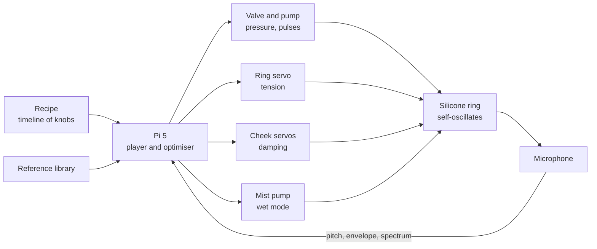

# Fart Valve

**Status:** concept, not built. Written 2026-11-13 from Nick's idea and Hideyuki Sawada's talking robot (Kagawa University, IEEE Spectrum, July 2011).
**Slug:** `fart-valve` · **Repo:** weeeha/fart-valve (stage 2) · **Page:** /projects/fart-valve (stage 6, unlisted)

## Pitch

A robot like Sawada's singing mouth, but the other end. A benchtop instrument that farts in
various ways, and every sound is real and physics-based: air through a soft silicone ring,
no speaker anywhere. It listens to itself and tunes until it matches the fart you asked for.

## The physics (why this is not a sound board)

The sound comes from a self-oscillating valve, the same physics as a trumpet player's lips
or Sawada's rubber vocal cords:

1. Pressure behind the ring pushes it open.
2. Air rushes through the gap; the fast flow drops the pressure in the gap (Bernoulli) and
   the ring's own elasticity pulls it shut.
3. Pressure builds again. The cycle repeats 30 to 300 times a second: that is the tone.

Four knobs set the character:

| Knob | Robot part | What it changes |
|---|---|---|
| Ring tension | servo pulling a drawstring around the silicone ring | pitch: tight squeak, loose rumble |
| Pressure and flow | pump, tank, fast valve | loudness, length, sputter (pulsed valve) |
| Cheek pads | two silicone pads on servos, pressed against the ring | buzz and damping: open is clean, pressed is muffled flutter |
| Wet mode | micro pump adding a fine water mist into the airflow | the crackle and splutter of a wet one |

## How it works

You pick a recipe ("short squeaker", "long rumbler", "sputter", "wet", "silent then late
squeak"). A recipe is a short timeline of the four knobs. The Pi plays it out, the microphone
records the result, and a small optimiser nudges the knob values toward a reference recording
of that kind of fart, measured by pitch track, loudness envelope and spectral shape. After
enough tries each recipe has learned settings that it replays on demand. Same self-listening
loop as Sawada's mouth.

## Look

One designed instrument, not a kit with parts glued on. A low PETG body like a piece of lab
or studio gear, the silicone ring set flush into its front face between the two cheek pads,
the tank and pump hidden inside, a small display and one big "play" button on top. Skin-tone
silicone against a matte warm-grey body: obviously what it is, never anatomical. No masts or
sticks: the microphone sits flush in a grille facing the ring.

## What is bought, cast, printed, written

| Bought | Cast and printed | Written |
|---|---|---|
| 12 V diaphragm pump, small tank, fast solenoid valve, pressure sensor, three servos, PCA9685, mist pump, Pi 5, USB microphone, 12 V supply, tubing | Silicone ring and cheek pads (Ecoflex, two-part printed moulds); PETG body with drawstring guide and ring seat; base with tank cradle | `brain/` recipe player, knob timeline, audio analysis (pitch, envelope, spectrum), optimiser that tunes recipes against reference clips; `recipes/*.yaml`; a CLI and a tiny web remote |

Parts with prices: `parts.md` (about CA$630 for the priced parts; tank, MOSFET board and tubing still unpriced).

## Constraints that bite

- **Ring wear and leaks.** A silicone ring buzzing hundreds of times a second will tear at the
  drawstring. The ring is a swappable cartridge that clicks into the body, cast with a fabric
  insert at the string channel.
- **Pressure range.** A real fart is a few kPa above ambient. The pump and tank aim at 2 to 15
  kPa with a relief valve; much more and the ring stops oscillating and just hisses.
- **Wet mode is messy.** Mist only, a few millilitres, a drip tray under the ring. Off by default.
- **Noise of the machine itself.** The pump hum would spoil the sound, so the tank is filled
  first and the pump stops while it plays.

## Build plan

| Phase | Work | Done when |
|---|---|---|
| 1 | Cast three test rings (Ecoflex 00-30, 00-50, Dragon Skin 10) and blow through them from a hand pump | One ring buzzes reliably between about 3 and 10 kPa |
| 2 | Pump, tank, valve, pressure sensor on the bench; Pi drives valve pulses | Pressure holds within 0.5 kPa; pulses audible as a sputter |
| 3 | Drawstring servo and cheek servos in a printed test rig | Pitch moves at least one octave with tension; cheeks audibly change the buzz |
| 4 | Recipe player and audio analysis; record 20 reference clips | Each recipe plays back the same way three times running |
| 5 | Optimiser loop; final body printed, wet mode added | Squeaker, rumbler and sputter each land closer to their reference than the starting settings |

## What the case study shows

- Stills (Blender render to photo): hero on a studio desk next to a mixing console; close-up
  of the silicone ring and cheek pads; top view with the recipe display; the ring cartridge
  out of the body beside it.
- Clip: the cheek pads close and the ring flutters, 6 s, from the hero photo.
- 3D viewer: the instrument body with ring and pads.
- Diagram: the loop above.

## Open questions Nick decides later

- Page placement: unlisted by URL only. Concept pages have a `draft` flag but no `unlisted`
  one yet; stage 6 adds an `unlisted` flag (kept out of the Concepts list, sitemap and search,
  as the unlisted work cases already are).
- Name on the page: "Fart Valve" plainly, or something drier ("Pneumatic Sphincter Study")?
- Should the clip have sound? The skill makes clips with no audio; a silent fart video is
  arguably the joke, but the point of the thing is the sound.
