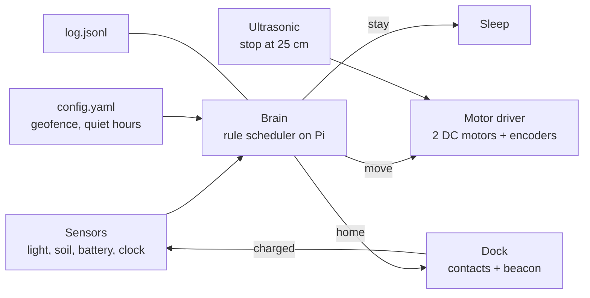

# Robot Planter (concept)

**Status:** concept, not built. Written 2026-11-06 from Nick's idea dump.
**Slug:** `robot-planter` · **Repo:** weeeha/robot-planter (stage 2) · **Page:** /vibefolio/robot-planter (stage 6)

## Pitch

A plant pot on wheels. It lives outside in one patch of the yard, sits still most of the day like
any pot, and walks around occasionally, maybe at night when nobody is looking. It finds the sun
when it wants it, rolls back to its dock to charge, and the only sign it moves is that it is
never quite where you left it.

## How it works

The pot is a bought wheeled chassis with a Raspberry Pi, a battery and three sensors, under a
3D-printed shell that holds a normal 15 cm plastic pot. A small scheduler on the Pi decides
when to move. Most of the time the answer is no.

1. **Sense.** Every ten minutes: light level, soil moisture, battery voltage, time of day.
2. **Decide.** A short rule list, not a model. Low light at midday and a brighter spot known
   from yesterday: move there. Battery under 30 %: go home. Night and nobody around (a quiet
   hour from the schedule): take a slow wander inside the geofence. Rain (moisture spike):
   stay. Otherwise: sleep.
3. **Move.** Differential drive at walking-cat speed, ultrasonic sensor stops it at anything
   closer than 25 cm, geofence is a square set in config, dead-reckoned from wheel encoders.
4. **Charge.** The dock is a pair of spring contacts on a printed ramp. The pot backs onto it
   using the light sensor on a small LED beacon, then sleeps until morning.

## What is bought, printed, written

| Bought | Printed | Written |
|---|---|---|
| Chassis with motors, Pi, motor HAT, battery + charger, dock contacts, moisture + light + ultrasonic sensors, 15 cm pot | Shell that hides the chassis and cradles the pot, clear dome for the light sensor, dock ramp with contact holders, battery tray | `brain/` scheduler and rules, `firmware/` motor, sensor and power drivers, `config/` geofence and quiet hours, a `log.jsonl` of every decision |

Parts with prices: `parts.md`.

## Build plan

| Phase | Work | Done when |
|---|---|---|
| 1 | Order parts. Print a test shell ring sized to the chassis footprint. | Parts on the desk, ring fits the chassis with 2 mm clearance |
| 2 | Pi drives the motors from a script, encoders count, ultrasonic stops it. | Rolls 2 m on the floor and stops at a shoe |
| 3 | Scheduler with rules and a geofence, runs for a day on the balcony with a log. | Log shows at least one sun move and one home move |
| 4 | Dock: ramp, contacts, beacon. Pot finds it from 1 m. | Three docks out of three, battery rising in the log |
| 5 | Full shell and dome, real pot and plant, two weeks outside. | Plant alive, pot still inside the fence, a video of a night wander |

## What the case study shows

- Stills: hero in a Montreal backyard at dusk, pot mid-roll on patio stones; printed shell
  detail with the sensor eyes; "caught in the act", a phone photo from a window at night, motion blur.
- Video: 8 to 10 s, the pot rolling slowly across a dark yard, one porch light, stops, settles.
- Diagram: the flowchart above.
- 3D: assembly viewer (GLB), shell over chassis, pot in the cradle.

## Open questions Nick decides later

- Wheels or tracks? The $50 Dagu chassis is a bench prototype; nothing cheap is rated for 2 kg
  on grass. Tracks (Tri-Track, ~$517) handle grass, wheels are quieter at night.
- Dock: no 12 V Qi receiver sold in Canada, so charging is spring contacts on the ramp plus a
  balance charger; the Qi pair only powers the Pi.
- Dead reckoning drifts; a cheap GPS or a second beacon may be needed for a fence larger than 3 m.
- Winter: it hibernates inside, or the dock gets a heater pad.
