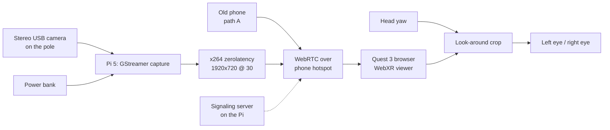

# Third Person

**Status:** concept, not built. Written 2026-11-06 from Nick's idea dump.
**Slug:** `third-person-vr` · **Repo:** weeeha/third-person-vr (stage 2) · **Page:** /vibefolio/third-person-vr (stage 6)

## Pitch

A third-person experience like in games, but in real life: a camera on a stick attached to your back, about a metre behind and above your head.
It streams live to a Quest 3, so you walk down your own street watching yourself from behind.
Built from cheap parts: an old phone to start, a USB stereo camera and a Raspberry Pi for real 3D.

## How it works

Capture, send, show, steer.

1. **Capture.** A camera sits on the end of a pole fixed to a backpack frame. Path A is an old phone (flat image). Path B is an ELP synced dual-lens USB camera that outputs both eyes side by side in one frame.
2. **Send.** For path B, a Raspberry Pi 5 in the backpack grabs the frame with GStreamer, encodes H.264 in software (the Pi 5 has no hardware encoder) and sends it over WebRTC. For path A, the phone's browser sends its own camera. Both go over a phone hotspot carried in a pocket, never the internet, so frames are not buffered.
3. **Show.** The Quest 3 browser opens a WebXR page from the Pi. It splits the side-by-side frame and shows the left half to the left eye and the right half to the right eye, on a curved screen in front of you.
4. **Steer.** Turning your head would normally do nothing, since the camera is bolted to your back. The viewer reads head yaw and slides the visible window across a wider frame (the 170° lens variant), so a glance left shows a bit more of the left side. All of this happens on the headset, with no trip back to the camera.

Target delay, glass to eye: under 200 ms on the hotspot (planned, not measured).

## What is bought, printed, written

| Bought | Printed | Written |
|---|---|---|
| ELP 960P synced stereo USB camera, Raspberry Pi 5 4GB with active cooler, 20,000 mAh USB-C PD power bank, Insta360 third-person backpack mount with its pole, microSD | Camera head pod with a 1/4"-20 insert, Pi and battery sled for the backpack, cable clips along the pole | GStreamer capture and WebRTC sender (Python), signaling server (aiohttp), WebXR stereo viewer (three.js), phone sender page, config |

Parts with prices: `parts.md`.

## Build plan

| Phase | Work | Done when |
|---|---|---|
| 1 | Phone path: one web page with "send" mode for the phone and "view" mode for the Quest, phone taped to the pole | Walking a hallway at slow pace while watching yourself from behind, without bumping into anything |
| 2 | Stereo path: ELP camera into the Pi 5, GStreamer to WebRTC, stereo split in the viewer | Depth reads on stairs and kerbs; delay measured with a stopwatch on screen |
| 3 | Print the camera pod and backpack sled, route the cable down the pole | Rig goes on and comes off in under a minute, nothing rattles |
| 4 | Look-around crop driven by head yaw, comfort settings (screen distance, dim on fast motion) | A 10-minute walk in a park without nausea |

## What the case study shows

- Stills: **hero**, someone walking a quiet street at dusk seen from the side and behind, the pole rising from the backpack, headset on. **POV**, what the headset shows: the walker's own back and shoulders from above, the street ahead. **Detail**, the printed camera pod on the tip of the pole, the stereo lenses visible.
- Video: from the POV still, the view follows the walker down the sidewalk, the pole camera swaying slightly, as in a game camera. 8 to 10 s.
- Diagram: the flowchart above, house style, the look-around crop as the dashed (least certain) card.
- 3D: assembly viewer (GLB): backpack frame, pole, camera pod, Pi sled.

## Open questions Nick decides later

- Pi 5 has no hardware H.264 encoder, so software x264 at 1920x720 is the plan. A Pi 4 has one but less CPU; a small mini PC would be easier but heavier. Keep the Pi 5?
- Title on the page: "Third Person" or something closer to the game reference?
