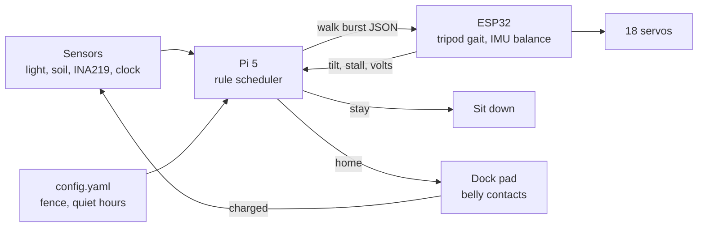

# Walking Planter

**Status:** concept, not built. Written 2026-11-07 from Nick's idea and the Waveshare HexArth.
**Slug:** `walking-planter` · **Repo:** weeeha/walking-planter · **Page:** /projects/walking-planter

## Pitch

The same plant pot that wanders the yard at night, but it walks. Six legs under a printed
shell, a pothos on its back. Most of the day it stands still like a strange pot on stilts;
when the sun moves, it gets up and follows it, a few slow steps at a time.

## Base: Waveshare HexArth

Bought, not built. What it brings (docs.waveshare.com/HexArth, waveshare.com/hexarth.htm):

| | |
|---|---|
| Legs | 6 legs, 18 serial bus servos, 12 V, 30 kg·cm stall, position and voltage feedback |
| Brain | ESP32-WROOM-32 with Wi-Fi, ICM20948 9-axis IMU, INA219 battery monitor, small OLED |
| Gait | Tripod gait and self-balancing in the stock firmware; JSON commands over serial, HTTP or ESP-NOW (`{"T":1,"X":0.02,"Y":0.02,"Yaw":0}`) |
| Host | Raspberry Pi 4B / 5 on the top plate over the 40-pin UART |
| Power | 3s2p 18650 pack (not included, 10C+), 12.6 V charger into a DC 5.5×2.1 jack |
| Size | 344 × 429 × 155 mm standing, 2.1 kg |
| Payload | **1 kg dynamic** |
| Price | US$439.99 at Waveshare |

## How it works

The Pi is the gardener, the ESP32 is the legs. Every ten minutes the Pi reads light and soil
moisture and asks the same four rules as the wheeled planter, first answer wins:

1. Battery under 30 % (INA219): walk home to the dock.
2. Moisture jumped: it is raining, stay.
3. Midday and dim here, brighter two metres over yesterday: walk there.
4. Quiet hours and a 30 % coin flip: a short wander inside the fence.

Otherwise it **sits**: the legs fold and the shell rests on the ground, so the servos are not
holding 3 kg all day. A move is: stand up, send walk commands in short bursts (the firmware
stops after 3 s without a command, which doubles as a dead-man switch), check the IMU for a
tilt or a stall, sit down. Heading comes from the IMU's magnetometer, distance from step count.

## What is bought, printed, written

| Bought | Printed | Written |
|---|---|---|
| HexArth kit, six 18650 cells, Pi 5, light sensor, capacitive moisture probe, a light 12 cm plastic pot | A carapace that bolts to the top plate, hides the Pi and cells, and cradles the pot; a flush clear dome for the light sensor; a dock pad with two spring contacts | `brain/` scheduler, sit/stand/walk bursts over the HexArth JSON API, IMU heading, dock approach; `config/`; the same `log.jsonl` |

No sensor mast this time: the light sensor sits under a small clear dome in the carapace
behind the pot.

## The weight budget (the real constraint)

1 kg dynamic payload. Carapace ~250 g PETG, Pi ~50 g, sensors ~20 g, so the planted pot gets
about **650 g**. A 15 cm terracotta pot with wet soil is ~2 kg, so this one is a 12 cm plastic
pot, a light mix with pumice, and a small pothos. That is the design brief for the carapace too:
thin walls, ribs, no solid fills.

## Build plan

| Phase | Work | Done when |
|---|---|---|
| 1 | Build the HexArth, cells in, stock web UI walks it | Walks 2 m on the floor, battery reads in the UI |
| 2 | Pi 5 on the top plate, JSON over UART: sit, stand, walk burst, read IMU | A script walks a 1 m square and sits |
| 3 | Print the carapace and pot cradle, weigh everything | Total payload under 1 kg on the scale, walks with it on |
| 4 | Scheduler, fence by step count + IMU heading, a day on the balcony | Log shows one sun move and one home walk |
| 5 | Dock pad with belly contacts wired to the charge jack; walk-on from 1 m | Three docks out of three, voltage rising |

## What the case study shows

- Photos (Blender render → photo): standing on the patio at dusk; close-up of a leg and the
  carapace edge; caught mid-step on the lawn at night from a window; sitting on the dock pad.
- Clip: six legs walking a few steps across the patio, from the dusk photo.
- 3D viewer: the HexArth with the carapace and pot.
- Diagram: the loop above.

## Open questions

- Does the stock tripod gait stay stable with the pot's centre of mass ~150 mm above the body?
  If not, the pot sits lower inside the carapace or the gait slows.
- Grass: the leg tips are smooth rubber; patio first, lawn later.
- Rain: the servos are not sealed. The carapace skirt helps but this is a fair-weather walker.
